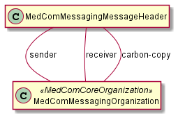

# MedComMessagingMessageHeader - DK MedCom Messaging v4.0.3

## Resource Profile: MedComMessagingMessageHeader 

| | |
| :--- | :--- |
| *Official URL*:http://medcomfhir.dk/ig/messaging/StructureDefinition/medcom-messaging-messageHeader | *Version*:4.0.3 |
| Active as of 2026-11-11 | *Computable Name*:MedComMessagingMessageHeader |

 
MessageHeader for MedCom messages 

### Scope and usage

MedComMessagingMessageHeader provides the routing and event information for a MedCom message. Individual messaging standards specialize this profile for their events and workflow. Required elements, destination slices, reference types, and narrative requirements are defined in the snapshot and element descriptions below.



## Message identity and acknowledgements

MessageHeader.id corresponds to the LetterId in MedCom OIOXML messages and identifies the message independently of the Bundle used to dispatch it. Its element definition specifies uniqueness for new messages and retention of the id for retransmissions. Carbon copies and forwards are new messages; see [copy and forward scenarios](message-exchange.md#scenario-2-sending-copies-of-a-medcommessagingmessage).

The id is used when describing message history in [MedComMessagingProvenance](StructureDefinition-medcom-messaging-provenance.md#history). When processing a message other than an Acknowledgement, the receiving system **SHALL** return an [Acknowledgement](https://medcomfhir.dk/ig/acknowledgement/) whose MessageHeader.response.identifier quotes the request's MessageHeader.id, so the sender can correlate the response with its request.

## Additional governance

| | |
| :--- | :--- |
| [HDR-07](#HDR-07) | A MedCom FHIR Message**SHALL**contain one bundled focused resource referenced by MessageHeader.focus. |

This requirement is not enforced by the base Messaging profile constraints. Hence why it's a rule here.

**Usages:**

* Refer to this Profile: [MedComMessagingProvenance](StructureDefinition-medcom-messaging-provenance.md)
* Examples for this Profile: [MessageHeader/3881874e-2042-4a00-aee8-23512799f512](MessageHeader-3881874e-2042-4a00-aee8-23512799f512.md), [MessageHeader/42c01434-8feb-11ec-b909-0242ac120002](MessageHeader-42c01434-8feb-11ec-b909-0242ac120002.md), [MessageHeader/cb0b2ef0-8feb-11ec-b909-0242ac120002](MessageHeader-cb0b2ef0-8feb-11ec-b909-0242ac120002.md) and [MessageHeader/d28b9cb4-8feb-11ec-b909-0242ac120002](MessageHeader-d28b9cb4-8feb-11ec-b909-0242ac120002.md)

You can also check for [usages in the FHIR IG Statistics](https://packages2.fhir.org/xig/resource/medcom.fhir.dk.messaging|current/StructureDefinition/StructureDefinition-medcom-messaging-messageHeader.json)

### Formal Views of Profile Content

 [Description of Profiles, Differentials, Snapshots and how the different presentations work](http://build.fhir.org/ig/FHIR/ig-guidance/readingIgs.html#structure-definitions). 

 

Other representations of profile: [CSV](StructureDefinition-medcom-messaging-messageHeader.csv), [Excel](StructureDefinition-medcom-messaging-messageHeader.xlsx), [Schematron](StructureDefinition-medcom-messaging-messageHeader.sch) 


## Resource Content

```json
{
  "resourceType" : "StructureDefinition",
  "id" : "medcom-messaging-messageHeader",
  "url" : "http://medcomfhir.dk/ig/messaging/StructureDefinition/medcom-messaging-messageHeader",
  "version" : "4.0.3",
  "name" : "MedComMessagingMessageHeader",
  "status" : "active",
  "date" : "2026-11-11T07:53:00+00:00",
  "publisher" : "MedCom",
  "contact" : [{
    "name" : "MedCom",
    "telecom" : [{
      "system" : "url",
      "value" : "http://www.medcom.dk"
    }]
  }],
  "description" : "MessageHeader for MedCom messages",
  "jurisdiction" : [{
    "coding" : [{
      "system" : "urn:iso:std:iso:3166",
      "code" : "DK",
      "display" : "Denmark"
    }]
  }],
  "fhirVersion" : "4.0.1",
  "mapping" : [{
    "identity" : "v2",
    "uri" : "http://hl7.org/v2",
    "name" : "HL7 v2 Mapping"
  },
  {
    "identity" : "rim",
    "uri" : "http://hl7.org/v3",
    "name" : "RIM Mapping"
  },
  {
    "identity" : "w5",
    "uri" : "http://hl7.org/fhir/fivews",
    "name" : "FiveWs Pattern Mapping"
  }],
  "kind" : "resource",
  "abstract" : false,
  "type" : "MessageHeader",
  "baseDefinition" : "http://hl7.org/fhir/StructureDefinition/MessageHeader",
  "derivation" : "constraint",
  "differential" : {
    "element" : [{
      "id" : "MessageHeader",
      "path" : "MessageHeader"
    },
    {
      "id" : "MessageHeader.id",
      "extension" : [{
        "extension" : [{
          "url" : "code",
          "valueCode" : "SHALL:in-narrative"
        },
        {
          "url" : "actor",
          "valueCanonical" : "http://medcomfhir.dk/ig/messaging/ActorDefinition/ProducerActor"
        }],
        "url" : "http://hl7.org/fhir/StructureDefinition/obligation"
      }],
      "path" : "MessageHeader.id",
      "short" : "Globally unique for each new message; retained for retransmissions.",
      "definition" : "Each newly created message SHALL have a globally unique MessageHeader.id. Retransmissions of the same message SHALL retain that id so the receiver can identify duplicates. A new Bundle.id does not require a new MessageHeader.id.",
      "min" : 1,
      "mustSupport" : true
    },
    {
      "id" : "MessageHeader.text",
      "path" : "MessageHeader.text",
      "short" : "The narrative text SHALL always be included when exchanging a MedCom FHIR Bundle.",
      "mustSupport" : true
    },
    {
      "id" : "MessageHeader.text.status",
      "path" : "MessageHeader.text.status",
      "mustSupport" : true
    },
    {
      "id" : "MessageHeader.text.div",
      "path" : "MessageHeader.text.div",
      "mustSupport" : true
    },
    {
      "id" : "MessageHeader.event[x]",
      "path" : "MessageHeader.event[x]",
      "short" : "The event element shall contain a value from MedComMessagingMessageTypes",
      "type" : [{
        "code" : "Coding"
      }],
      "mustSupport" : true,
      "binding" : {
        "strength" : "required",
        "valueSet" : "http://medcomfhir.dk/ig/terminology/ValueSet/medcom-messaging-messageTypes"
      }
    },
    {
      "id" : "MessageHeader.event[x].system",
      "path" : "MessageHeader.event[x].system",
      "min" : 1,
      "mustSupport" : true
    },
    {
      "id" : "MessageHeader.event[x].code",
      "extension" : [{
        "extension" : [{
          "url" : "code",
          "valueCode" : "SHALL:in-narrative"
        },
        {
          "url" : "actor",
          "valueCanonical" : "http://medcomfhir.dk/ig/messaging/ActorDefinition/ProducerActor"
        }],
        "url" : "http://hl7.org/fhir/StructureDefinition/obligation"
      }],
      "path" : "MessageHeader.event[x].code",
      "min" : 1,
      "mustSupport" : true
    },
    {
      "id" : "MessageHeader.destination",
      "path" : "MessageHeader.destination",
      "slicing" : {
        "discriminator" : [{
          "type" : "value",
          "path" : "extension('http://medcomfhir.dk/ig/messaging/StructureDefinition/medcom-messaging-destinationUseExtension').value.code"
        }],
        "rules" : "closed"
      },
      "min" : 1,
      "mustSupport" : true
    },
    {
      "id" : "MessageHeader.destination:primary",
      "path" : "MessageHeader.destination",
      "sliceName" : "primary",
      "min" : 1,
      "max" : "1",
      "mustSupport" : true
    },
    {
      "id" : "MessageHeader.destination:primary.extension",
      "path" : "MessageHeader.destination.extension",
      "slicing" : {
        "discriminator" : [{
          "type" : "value",
          "path" : "url"
        }],
        "ordered" : false,
        "rules" : "open"
      },
      "min" : 1
    },
    {
      "id" : "MessageHeader.destination:primary.extension:use",
      "path" : "MessageHeader.destination.extension",
      "sliceName" : "use",
      "min" : 1,
      "max" : "1",
      "type" : [{
        "code" : "Extension",
        "profile" : ["http://medcomfhir.dk/ig/messaging/StructureDefinition/medcom-messaging-destinationUseExtension"]
      }],
      "mustSupport" : true
    },
    {
      "id" : "MessageHeader.destination:primary.extension:use.value[x].system",
      "path" : "MessageHeader.destination.extension.value[x].system",
      "patternUri" : "http://medcomfhir.dk/ig/terminology/CodeSystem/medcom-messaging-destinationUse"
    },
    {
      "id" : "MessageHeader.destination:primary.extension:use.value[x].code",
      "path" : "MessageHeader.destination.extension.value[x].code",
      "patternCode" : "primary"
    },
    {
      "id" : "MessageHeader.destination:primary.endpoint",
      "extension" : [{
        "extension" : [{
          "url" : "code",
          "valueCode" : "SHALL:in-narrative"
        },
        {
          "url" : "actor",
          "valueCanonical" : "http://medcomfhir.dk/ig/messaging/ActorDefinition/ProducerActor"
        }],
        "url" : "http://hl7.org/fhir/StructureDefinition/obligation"
      }],
      "path" : "MessageHeader.destination.endpoint",
      "mustSupport" : true
    },
    {
      "id" : "MessageHeader.destination:primary.receiver",
      "extension" : [{
        "extension" : [{
          "url" : "code",
          "valueCode" : "SHALL:in-narrative"
        },
        {
          "url" : "actor",
          "valueCanonical" : "http://medcomfhir.dk/ig/messaging/ActorDefinition/ProducerActor"
        }],
        "url" : "http://hl7.org/fhir/StructureDefinition/obligation"
      }],
      "path" : "MessageHeader.destination.receiver",
      "short" : "The primary reciever of the message",
      "min" : 1,
      "type" : [{
        "code" : "Reference",
        "targetProfile" : ["http://medcomfhir.dk/ig/messaging/StructureDefinition/medcom-messaging-organization"],
        "aggregation" : ["bundled"]
      }],
      "mustSupport" : true
    },
    {
      "id" : "MessageHeader.destination:cc",
      "path" : "MessageHeader.destination",
      "sliceName" : "cc",
      "min" : 0,
      "max" : "*",
      "mustSupport" : true
    },
    {
      "id" : "MessageHeader.destination:cc.extension",
      "path" : "MessageHeader.destination.extension",
      "slicing" : {
        "discriminator" : [{
          "type" : "value",
          "path" : "url"
        }],
        "ordered" : false,
        "rules" : "open"
      },
      "min" : 1
    },
    {
      "id" : "MessageHeader.destination:cc.extension:use",
      "path" : "MessageHeader.destination.extension",
      "sliceName" : "use",
      "min" : 1,
      "max" : "1",
      "type" : [{
        "code" : "Extension",
        "profile" : ["http://medcomfhir.dk/ig/messaging/StructureDefinition/medcom-messaging-destinationUseExtension"]
      }],
      "mustSupport" : true
    },
    {
      "id" : "MessageHeader.destination:cc.extension:use.value[x].system",
      "path" : "MessageHeader.destination.extension.value[x].system",
      "patternUri" : "http://medcomfhir.dk/ig/terminology/CodeSystem/medcom-messaging-destinationUse"
    },
    {
      "id" : "MessageHeader.destination:cc.extension:use.value[x].code",
      "path" : "MessageHeader.destination.extension.value[x].code",
      "patternCode" : "cc"
    },
    {
      "id" : "MessageHeader.destination:cc.endpoint",
      "extension" : [{
        "extension" : [{
          "url" : "code",
          "valueCode" : "SHALL:in-narrative"
        },
        {
          "url" : "actor",
          "valueCanonical" : "http://medcomfhir.dk/ig/messaging/ActorDefinition/ProducerActor"
        }],
        "url" : "http://hl7.org/fhir/StructureDefinition/obligation"
      }],
      "path" : "MessageHeader.destination.endpoint",
      "mustSupport" : true
    },
    {
      "id" : "MessageHeader.destination:cc.receiver",
      "extension" : [{
        "extension" : [{
          "url" : "code",
          "valueCode" : "SHALL:in-narrative"
        },
        {
          "url" : "actor",
          "valueCanonical" : "http://medcomfhir.dk/ig/messaging/ActorDefinition/ProducerActor"
        }],
        "url" : "http://hl7.org/fhir/StructureDefinition/obligation"
      }],
      "path" : "MessageHeader.destination.receiver",
      "short" : "The carbon copy reciever of the message. Is only used when a message has multiple recievers.",
      "min" : 1,
      "type" : [{
        "code" : "Reference",
        "targetProfile" : ["http://medcomfhir.dk/ig/messaging/StructureDefinition/medcom-messaging-organization"],
        "aggregation" : ["bundled"]
      }],
      "mustSupport" : true
    },
    {
      "id" : "MessageHeader.sender",
      "extension" : [{
        "extension" : [{
          "url" : "code",
          "valueCode" : "SHALL:in-narrative"
        },
        {
          "url" : "actor",
          "valueCanonical" : "http://medcomfhir.dk/ig/messaging/ActorDefinition/ProducerActor"
        }],
        "url" : "http://hl7.org/fhir/StructureDefinition/obligation"
      }],
      "path" : "MessageHeader.sender",
      "short" : "The actual sender of the message",
      "min" : 1,
      "type" : [{
        "code" : "Reference",
        "targetProfile" : ["http://medcomfhir.dk/ig/messaging/StructureDefinition/medcom-messaging-organization"],
        "aggregation" : ["bundled"]
      }],
      "mustSupport" : true
    },
    {
      "id" : "MessageHeader.source",
      "path" : "MessageHeader.source",
      "short" : "Contains the information about the target for the Acknowledgement message.",
      "mustSupport" : true
    },
    {
      "id" : "MessageHeader.source.endpoint",
      "extension" : [{
        "extension" : [{
          "url" : "code",
          "valueCode" : "SHALL:in-narrative"
        },
        {
          "url" : "actor",
          "valueCanonical" : "http://medcomfhir.dk/ig/messaging/ActorDefinition/ProducerActor"
        }],
        "url" : "http://hl7.org/fhir/StructureDefinition/obligation"
      }],
      "path" : "MessageHeader.source.endpoint",
      "mustSupport" : true
    },
    {
      "id" : "MessageHeader.definition",
      "path" : "MessageHeader.definition",
      "mustSupport" : true
    }]
  }
}

```
