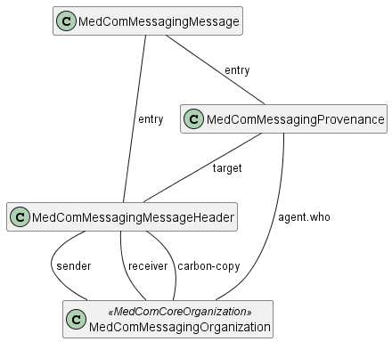

# MedComMessagingMessage - DK MedCom Messaging v4.0.3

## Resource Profile: MedComMessagingMessage 

| | |
| :--- | :--- |
| *Official URL*:http://medcomfhir.dk/ig/messaging/StructureDefinition/medcom-messaging-message | *Version*:4.0.3 |
| Active as of 2026-11-11 | *Computable Name*:MedComMessagingMessage |

 
Base resource for all MedCom messages. 

## Scope and usage

MedComMessagingMessage is the common Bundle profile used by MedCom messaging standards. Individual standards specialize it for their clinical content and corresponding MessageHeader profile. The snapshot and constraints below define the required structure.



## Additional governance

The following requirements are not expressed as constraints on this Bundle profile.

| | |
| :--- | :--- |
| [MSG-04](#MSG-04) | A MedCom FHIR Message**SHALL**contain at least two bundled MedComMessagingOrganization resources. |
| [MSG-10](#MSG-10) | With the exception of an acknowledgement message; A MedCom FHIR Message**SHALL**contain at least one bundled MedComCorePatient resource. |

Validation before dispatch and before processing received messages is governed by [Messaging validation governance](validation-governance.md#fhir-messaging-validation-governance).

## Bundle identifiers and dispatch time

Bundle.id corresponds to the EnvelopeId in MedCom OIOXML messages. Each time a message is dispatched, the sender **SHALL** assign a new globally unique Bundle.id; it **SHALL NOT** reuse the id of a previously dispatched Bundle. A new Bundle.id does not change the identity of the message carried in the Bundle; see [MessageHeader identity](StructureDefinition-medcom-messaging-messageHeader.md#message-identity-and-acknowledgements).

The optional Bundle.identifier can be assigned explicitly by the sending application and **MAY** have the same value as Bundle.id.

Bundle.timestamp records the dispatch time of the message. See [Provenance timestamps](StructureDefinition-medcom-messaging-provenance.md#provenance-timestamps) for the sending activity's timestamps and [reliable messaging](message-exchange.md#reliable-messaging-using-medcom-fhir-messaging) for retry handling.

**Usages:**

* Examples for this Profile: [Bundle/eb26be85-fdb7-454d-a980-95cba6d1745b](Bundle-eb26be85-fdb7-454d-a980-95cba6d1745b.md)

You can also check for [usages in the FHIR IG Statistics](https://packages2.fhir.org/xig/resource/medcom.fhir.dk.messaging|current/StructureDefinition/StructureDefinition-medcom-messaging-message.json)

### Formal Views of Profile Content

 [Description of Profiles, Differentials, Snapshots and how the different presentations work](http://build.fhir.org/ig/FHIR/ig-guidance/readingIgs.html#structure-definitions). 

 

Other representations of profile: [CSV](StructureDefinition-medcom-messaging-message.csv), [Excel](StructureDefinition-medcom-messaging-message.xlsx), [Schematron](StructureDefinition-medcom-messaging-message.sch) 


## Resource Content

```json
{
  "resourceType" : "StructureDefinition",
  "id" : "medcom-messaging-message",
  "url" : "http://medcomfhir.dk/ig/messaging/StructureDefinition/medcom-messaging-message",
  "version" : "4.0.3",
  "name" : "MedComMessagingMessage",
  "status" : "active",
  "date" : "2026-11-11T07:55:32+00:00",
  "publisher" : "MedCom",
  "contact" : [{
    "name" : "MedCom",
    "telecom" : [{
      "system" : "url",
      "value" : "http://www.medcom.dk"
    }]
  }],
  "description" : "Base resource for all MedCom messages.",
  "jurisdiction" : [{
    "coding" : [{
      "system" : "urn:iso:std:iso:3166",
      "code" : "DK",
      "display" : "Denmark"
    }]
  }],
  "fhirVersion" : "4.0.1",
  "mapping" : [{
    "identity" : "v2",
    "uri" : "http://hl7.org/v2",
    "name" : "HL7 v2 Mapping"
  },
  {
    "identity" : "rim",
    "uri" : "http://hl7.org/v3",
    "name" : "RIM Mapping"
  },
  {
    "identity" : "cda",
    "uri" : "http://hl7.org/v3/cda",
    "name" : "CDA (R2)"
  },
  {
    "identity" : "w5",
    "uri" : "http://hl7.org/fhir/fivews",
    "name" : "FiveWs Pattern Mapping"
  }],
  "kind" : "resource",
  "abstract" : false,
  "type" : "Bundle",
  "baseDefinition" : "http://hl7.org/fhir/StructureDefinition/Bundle",
  "derivation" : "constraint",
  "differential" : {
    "element" : [{
      "id" : "Bundle",
      "path" : "Bundle",
      "constraint" : [{
        "key" : "medcom-messaging-2",
        "severity" : "error",
        "human" : "There shall be at least one Provenance resource in a MedCom message",
        "expression" : "entry.resource.ofType(Provenance).exists()",
        "source" : "http://medcomfhir.dk/ig/messaging/StructureDefinition/medcom-messaging-message"
      }]
    },
    {
      "id" : "Bundle.id",
      "path" : "Bundle.id",
      "min" : 1,
      "mustSupport" : true
    },
    {
      "id" : "Bundle.type",
      "path" : "Bundle.type",
      "short" : "Always message",
      "patternCode" : "message",
      "mustSupport" : true
    },
    {
      "id" : "Bundle.timestamp",
      "path" : "Bundle.timestamp",
      "min" : 1,
      "mustSupport" : true
    },
    {
      "id" : "Bundle.entry",
      "path" : "Bundle.entry",
      "mustSupport" : true
    },
    {
      "id" : "Bundle.entry.resource",
      "path" : "Bundle.entry.resource",
      "short" : "Message contents. Invariant medcom-messaging-2 requires at least one Provenance resource; inherited bdl-12 requires a MessageHeader as the first resource.",
      "mustSupport" : true
    }]
  }
}

```
