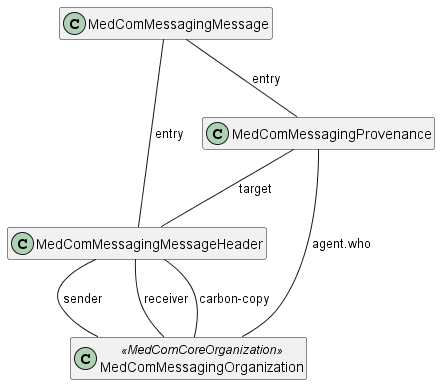

# Home - DK MedCom Messaging v4.0.3

| | |
| :--- | :--- |
| *Official URL*:http://medcomfhir.dk/ig/messaging/ImplementationGuide/medcom.fhir.dk.messaging | *Version*:4.0.3 |
| Active as of 2026-11-11 | *Computable Name*:DK MedCom Messaging |

### Introduction

This Implementation Guide (IG) is provided by MedCom to describe the use of FHIR ®© in message based exchange of data in Danish healthcare.

### Scope of the messaging framework

MedCom has profiled the [HL7 FHIR Messaging Framework](http://hl7.org/fhir/R4/messaging.html) to work in a Danish context. Governance for MedCom HL7 FHIR Messaging describes the basic ruleset of how MedCom Messages must be exchanged in the Danish Healthcare Messaging Network. The Danish ruleset is based on:

* the ruleset for the Danish VANS Network
* the general [HL7 FHIR Communication Rules for FHIR Messaging](http://hl7.org/fhir/R4/messaging.html)
* the Danish profiling of FHIR messaging.

These MedCom FHIR Messaging Governance rules are intended to clarify the use of MedCom’s FHIR messages for the health and social area. Formerly, these kinds of rules for other MedCom Messaging paradigms were known as ”Syntax & Communication Rules”.

It is the intention that the MedCom FHIR Messaging Governance rules together with MedCom’s FHIR standards for the individual messages form the full and sufficient basis for implementing MedCom’s healthcare messages.

#### General Messaging Model

The figure below illustrates a general messaging model, which all MedCom messages will comply to. Messaging profiles are all prefixed "MedComMessaging". Beside the profiles on the figure, a MedCom message will also include some MedComCore profiles and profiles made to support a specific use case. All together they constitute the actual content of a MedCom message. The following sections describe the overall purpose of each messaging profile.



##### MedComMessagingMessage

A Bundle resource defined to be of the type 'message'. All profiles included in a message shall be referenced from the entry element in the MedComMessagingMessage profile, with a MessageHeader as the first resource.

**Note:** Be aware that entries in a message in general are unordered. Recipients of a message cannot assume any sequences of profiles.

##### MedComMessagingMessageHeader

The MessageHeader defines the sender and receiver organization of a message. In some messages it is optional to include a one or more carbon-copy receiver organization(s). From the focus element is the actual content of the message often referenced, like a Communication or Encounter resource.

##### MedComMessagingOrganization

This profile inherits from MedComCoreOrganization and is used to describe a sender and receiver organization. The resource constrains the MedComCoreOrganization profile to contain both a SOR identifier and an EAN identifier (also known as GLN) for addressing purposes.

##### MedComMessagingProvenance

The Provenance resource describes the activity of the message and who has triggered the message. Further is it used to describes the history of message activities e.g., if the message is related to a previously exchanged message.

### Terms and abbreviations

This table presents the most commonly used terms and abbreviations used to describe the Governance for MedCom FHIR messaging. In the table below, each term or abbreviation has an associated description that eloborates the meaning of the term. For some terms is a link provided, which includes more information about the term.

| | | |
| :--- | :--- | :--- |
| EAN | Location Number issued by the GS1 organization through its partners all over the world - in Denmark SDS ( also known as GLN, Location number). Location numbers and related electronic message types are used for electronic message-based communication between the health service parties | [Only Danish](https://www.medcom.dk/opslag/support/sundhedsvaesenets-organisationsregister-sor)- further links on that page |
| SDS | Sundhedsdatastyrelsen (The Danish Health Data Authority) | [Danish](https://sundhedsdatastyrelsen.dk/da/)&[English](https://sundhedsdatastyrelsen.dk/da/english) |
| SOR | Sundhedsvæsenets Organisations Register (Healthcare Organization Register in Denmark ) | [Only Danish](https://sundhedsdatastyrelsen.dk/da/rammer-og-retningslinjer/organisationsregistrering) |
| VANS | VANS is an abbreviation of Value Added Network Services, in Denmark an Asynchronous Network run by 3 private suppliers | [KMD](https://www.kmd.dk/),[MiltiMed A/S](https://www.multimed.dk/kommunikation/),[TrueCommerce](https://www.truecommerce.com/dk-da/) |
| Dispatch | Dispatch of a message means the process in the Sending System, where a message is send | N/A |
| Shipment | Shipment of a message means the whole process from dispatchment in the Sending System to reception in the Receiving System | N/A |
| Sending System | The system that dispatches a message | N/A |
| Receiving System | The system that receives a shipped message | N/A |
| MSH | Abbreviation for Message Service Handler. The part of a system that dispatches a message or receives a message | N/A |
| FHIR MSH | FHIR Message Service Handler. The part of a system that dispatches a FHIR message or receives a FHIR message | N/A |
| VANSEnvelope MSH | VANSEnvelope Message Service Handler. The part of a system that dispatches a VANSEnvelope message or receives a VANSEnvelope message | N/A |
| Sending Ecosystem | The collection of Sending System, Sending FHIR MSH and Sending VANSEnvelope MSH, that dispatches a message | N/A |
| Receiving Ecosystem | The collection of Receiving System, Receiving FHIR MSH and Receiving VANSEnvelope MSH, that receives a message | N/A |


## Resource Content

```json
{
  "resourceType" : "ImplementationGuide",
  "id" : "medcom.fhir.dk.messaging",
  "url" : "http://medcomfhir.dk/ig/messaging/ImplementationGuide/medcom.fhir.dk.messaging",
  "version" : "4.0.3",
  "name" : "DK MedCom Messaging",
  "title" : "DK MedCom Messaging",
  "status" : "active",
  "date" : "2026-11-11T07:55:32+00:00",
  "publisher" : "MedCom",
  "contact" : [{
    "name" : "MedCom",
    "telecom" : [{
      "system" : "url",
      "value" : "http://www.medcom.dk"
    }]
  }],
  "description" : "This IG includes messaging profiles defined by MedCom. These profiles are used in messagebased communication.",
  "jurisdiction" : [{
    "coding" : [{
      "system" : "urn:iso:std:iso:3166",
      "code" : "DK",
      "display" : "Denmark"
    }]
  }],
  "packageId" : "medcom.fhir.dk.messaging",
  "license" : "CC0-1.0",
  "fhirVersion" : ["4.0.1"],
  "dependsOn" : [{
    "id" : "hl7tx",
    "extension" : [{
      "url" : "http://hl7.org/fhir/tools/StructureDefinition/implementationguide-dependency-comment",
      "valueMarkdown" : "Automatically added as a dependency - all IGs depend on HL7 Terminology"
    }],
    "uri" : "http://terminology.hl7.org/ImplementationGuide/hl7.terminology",
    "packageId" : "hl7.terminology.r4",
    "version" : "7.5.0"
  },
  {
    "id" : "hl7ext",
    "extension" : [{
      "url" : "http://hl7.org/fhir/tools/StructureDefinition/implementationguide-dependency-comment",
      "valueMarkdown" : "Automatically added as a dependency - all IGs depend on the HL7 Extension Pack"
    }],
    "uri" : "http://hl7.org/fhir/extensions/ImplementationGuide/hl7.fhir.uv.extensions",
    "packageId" : "hl7.fhir.uv.extensions.r4",
    "version" : "5.4.0"
  },
  {
    "id" : "hl7_fhir_dk_core",
    "uri" : "http://hl7.dk/fhir/core/ImplementationGuide/hl7.fhir.dk.core",
    "packageId" : "hl7.fhir.dk.core",
    "version" : "3.4.0"
  },
  {
    "id" : "medcom_fhir_dk_core",
    "uri" : "http://medcomfhir.dk/ig/core/ImplementationGuide/medcom.fhir.dk.core",
    "packageId" : "medcom.fhir.dk.core",
    "version" : "3.0.1"
  }],
  "definition" : {
    "extension" : [{
      "url" : "http://hl7.org/fhir/tools/StructureDefinition/ig-internal-dependency",
      "valueCode" : "hl7.fhir.uv.tools.r4#1.3.0"
    },
    {
      "extension" : [{
        "url" : "code",
        "valueCode" : "copyrightyear"
      },
      {
        "url" : "value",
        "valueString" : "2021+"
      }],
      "url" : "http://hl7.org/fhir/tools/StructureDefinition/ig-parameter"
    },
    {
      "extension" : [{
        "url" : "code",
        "valueCode" : "releaselabel"
      },
      {
        "url" : "value",
        "valueString" : "release"
      }],
      "url" : "http://hl7.org/fhir/tools/StructureDefinition/ig-parameter"
    },
    {
      "extension" : [{
        "url" : "code",
        "valueCode" : "path-history"
      },
      {
        "url" : "value",
        "valueString" : "history.html"
      }],
      "url" : "http://hl7.org/fhir/tools/StructureDefinition/ig-parameter"
    },
    {
      "extension" : [{
        "url" : "code",
        "valueCode" : "apply-contact"
      },
      {
        "url" : "value",
        "valueString" : "true"
      }],
      "url" : "http://hl7.org/fhir/tools/StructureDefinition/ig-parameter"
    },
    {
      "extension" : [{
        "url" : "code",
        "valueCode" : "apply-jurisdiction"
      },
      {
        "url" : "value",
        "valueString" : "true"
      }],
      "url" : "http://hl7.org/fhir/tools/StructureDefinition/ig-parameter"
    },
    {
      "extension" : [{
        "url" : "code",
        "valueCode" : "apply-publisher"
      },
      {
        "url" : "value",
        "valueString" : "true"
      }],
      "url" : "http://hl7.org/fhir/tools/StructureDefinition/ig-parameter"
    },
    {
      "extension" : [{
        "url" : "code",
        "valueCode" : "pin-canonicals"
      },
      {
        "url" : "value",
        "valueString" : "pin-multiples"
      }],
      "url" : "http://hl7.org/fhir/tools/StructureDefinition/ig-parameter"
    },
    {
      "extension" : [{
        "url" : "code",
        "valueCode" : "excludettl"
      },
      {
        "url" : "value",
        "valueString" : "true"
      }],
      "url" : "http://hl7.org/fhir/tools/StructureDefinition/ig-parameter"
    },
    {
      "extension" : [{
        "url" : "code",
        "valueCode" : "autoload-resources"
      },
      {
        "url" : "value",
        "valueString" : "true"
      }],
      "url" : "http://hl7.org/fhir/tools/StructureDefinition/ig-parameter"
    },
    {
      "extension" : [{
        "url" : "code",
        "valueCode" : "path-liquid"
      },
      {
        "url" : "value",
        "valueString" : "template/liquid"
      }],
      "url" : "http://hl7.org/fhir/tools/StructureDefinition/ig-parameter"
    },
    {
      "extension" : [{
        "url" : "code",
        "valueCode" : "path-liquid"
      },
      {
        "url" : "value",
        "valueString" : "input/liquid"
      }],
      "url" : "http://hl7.org/fhir/tools/StructureDefinition/ig-parameter"
    },
    {
      "extension" : [{
        "url" : "code",
        "valueCode" : "path-qa"
      },
      {
        "url" : "value",
        "valueString" : "temp/qa"
      }],
      "url" : "http://hl7.org/fhir/tools/StructureDefinition/ig-parameter"
    },
    {
      "extension" : [{
        "url" : "code",
        "valueCode" : "path-temp"
      },
      {
        "url" : "value",
        "valueString" : "temp/pages"
      }],
      "url" : "http://hl7.org/fhir/tools/StructureDefinition/ig-parameter"
    },
    {
      "extension" : [{
        "url" : "code",
        "valueCode" : "path-output"
      },
      {
        "url" : "value",
        "valueString" : "output"
      }],
      "url" : "http://hl7.org/fhir/tools/StructureDefinition/ig-parameter"
    },
    {
      "extension" : [{
        "url" : "code",
        "valueCode" : "path-suppressed-warnings"
      },
      {
        "url" : "value",
        "valueString" : "input/ignoreWarnings.txt"
      }],
      "url" : "http://hl7.org/fhir/tools/StructureDefinition/ig-parameter"
    },
    {
      "extension" : [{
        "url" : "code",
        "valueCode" : "template-html"
      },
      {
        "url" : "value",
        "valueString" : "template-page.html"
      }],
      "url" : "http://hl7.org/fhir/tools/StructureDefinition/ig-parameter"
    },
    {
      "extension" : [{
        "url" : "code",
        "valueCode" : "template-md"
      },
      {
        "url" : "value",
        "valueString" : "template-page-md.html"
      }],
      "url" : "http://hl7.org/fhir/tools/StructureDefinition/ig-parameter"
    },
    {
      "extension" : [{
        "url" : "code",
        "valueCode" : "apply-context"
      },
      {
        "url" : "value",
        "valueString" : "true"
      }],
      "url" : "http://hl7.org/fhir/tools/StructureDefinition/ig-parameter"
    },
    {
      "extension" : [{
        "url" : "code",
        "valueCode" : "apply-copyright"
      },
      {
        "url" : "value",
        "valueString" : "true"
      }],
      "url" : "http://hl7.org/fhir/tools/StructureDefinition/ig-parameter"
    },
    {
      "extension" : [{
        "url" : "code",
        "valueCode" : "apply-license"
      },
      {
        "url" : "value",
        "valueString" : "true"
      }],
      "url" : "http://hl7.org/fhir/tools/StructureDefinition/ig-parameter"
    },
    {
      "extension" : [{
        "url" : "code",
        "valueCode" : "apply-version"
      },
      {
        "url" : "value",
        "valueString" : "true"
      }],
      "url" : "http://hl7.org/fhir/tools/StructureDefinition/ig-parameter"
    },
    {
      "extension" : [{
        "url" : "code",
        "valueCode" : "apply-wg"
      },
      {
        "url" : "value",
        "valueString" : "true"
      }],
      "url" : "http://hl7.org/fhir/tools/StructureDefinition/ig-parameter"
    },
    {
      "extension" : [{
        "url" : "code",
        "valueCode" : "active-tables"
      },
      {
        "url" : "value",
        "valueString" : "true"
      }],
      "url" : "http://hl7.org/fhir/tools/StructureDefinition/ig-parameter"
    },
    {
      "extension" : [{
        "url" : "code",
        "valueCode" : "fmm-definition"
      },
      {
        "url" : "value",
        "valueString" : "http://hl7.org/fhir/versions.html#maturity"
      }],
      "url" : "http://hl7.org/fhir/tools/StructureDefinition/ig-parameter"
    },
    {
      "extension" : [{
        "url" : "code",
        "valueCode" : "propagate-status"
      },
      {
        "url" : "value",
        "valueString" : "true"
      }],
      "url" : "http://hl7.org/fhir/tools/StructureDefinition/ig-parameter"
    },
    {
      "extension" : [{
        "url" : "code",
        "valueCode" : "excludelogbinaryformat"
      },
      {
        "url" : "value",
        "valueString" : "true"
      }],
      "url" : "http://hl7.org/fhir/tools/StructureDefinition/ig-parameter"
    },
    {
      "extension" : [{
        "url" : "code",
        "valueCode" : "tabbed-snapshots"
      },
      {
        "url" : "value",
        "valueString" : "true"
      }],
      "url" : "http://hl7.org/fhir/tools/StructureDefinition/ig-parameter"
    }],
    "resource" : [{
      "extension" : [{
        "url" : "http://hl7.org/fhir/tools/StructureDefinition/resource-information",
        "valueString" : "Organization"
      },
      {
        "url" : "http://hl7.org/fhir/StructureDefinition/implementationguide-page",
        "valueUri" : "Organization-12ee0dde-a672-462f-820d-5efe832d73c9.html"
      }],
      "reference" : {
        "reference" : "Organization/12ee0dde-a672-462f-820d-5efe832d73c9"
      },
      "name" : "Aros Burn Center",
      "description" : "A core organization with a SOR identifier.",
      "exampleBoolean" : true
    },
    {
      "extension" : [{
        "url" : "http://hl7.org/fhir/tools/StructureDefinition/resource-information",
        "valueString" : "Bundle"
      },
      {
        "url" : "http://hl7.org/fhir/StructureDefinition/implementationguide-page",
        "valueUri" : "Bundle-eb26be85-fdb7-454d-a980-95cba6d1745b.html"
      }],
      "reference" : {
        "reference" : "Bundle/eb26be85-fdb7-454d-a980-95cba6d1745b"
      },
      "name" : "Bundle used in an empty message.",
      "description" : "Example of an empty message.",
      "exampleCanonical" : "http://medcomfhir.dk/ig/messaging/StructureDefinition/medcom-messaging-message"
    },
    {
      "extension" : [{
        "url" : "http://hl7.org/fhir/tools/StructureDefinition/resource-information",
        "valueString" : "Patient"
      },
      {
        "url" : "http://hl7.org/fhir/StructureDefinition/implementationguide-page",
        "valueUri" : "Patient-733cef33-3626-422b-955d-d506aaa65fe1.html"
      }],
      "reference" : {
        "reference" : "Patient/733cef33-3626-422b-955d-d506aaa65fe1"
      },
      "name" : "Eric Flame",
      "description" : "Patient with a managing organization. Valid only if used in a bundle (message).",
      "exampleBoolean" : true
    },
    {
      "extension" : [{
        "url" : "http://hl7.org/fhir/tools/StructureDefinition/resource-information",
        "valueString" : "Organization"
      },
      {
        "url" : "http://hl7.org/fhir/StructureDefinition/implementationguide-page",
        "valueUri" : "Organization-74cdf292-abf3-4f5f-80ea-60a48013ff6d.html"
      }],
      "reference" : {
        "reference" : "Organization/74cdf292-abf3-4f5f-80ea-60a48013ff6d"
      },
      "name" : "Example of a reciever organization with a SOR and an EAN identifier.",
      "description" : "Example of an organization with a SOR and an EAN identifier.",
      "exampleCanonical" : "http://medcomfhir.dk/ig/messaging/StructureDefinition/medcom-messaging-organization"
    },
    {
      "extension" : [{
        "url" : "http://hl7.org/fhir/tools/StructureDefinition/resource-information",
        "valueString" : "Organization"
      },
      {
        "url" : "http://hl7.org/fhir/StructureDefinition/implementationguide-page",
        "valueUri" : "Organization-42541447-b58c-4a1a-9514-02b80494bbd3.html"
      }],
      "reference" : {
        "reference" : "Organization/42541447-b58c-4a1a-9514-02b80494bbd3"
      },
      "name" : "Example of a reciever organization with a SOR, an EAN  and Ydrenummer identifier.",
      "description" : "Example of an organization with a SOR and an EAN and Ydrenummer identifier.",
      "exampleCanonical" : "http://medcomfhir.dk/ig/messaging/StructureDefinition/medcom-requesterorganization"
    },
    {
      "extension" : [{
        "url" : "http://hl7.org/fhir/tools/StructureDefinition/resource-information",
        "valueString" : "Organization"
      },
      {
        "url" : "http://hl7.org/fhir/StructureDefinition/implementationguide-page",
        "valueUri" : "Organization-d7056980-a8b2-42aa-8a0e-c1fc85d1f40d.html"
      }],
      "reference" : {
        "reference" : "Organization/d7056980-a8b2-42aa-8a0e-c1fc85d1f40d"
      },
      "name" : "Example of a sender organization with a SOR and an EAN identifier.",
      "description" : "Example of an organization with a SOR and an EAN identifier.",
      "exampleCanonical" : "http://medcomfhir.dk/ig/messaging/StructureDefinition/medcom-messaging-organization"
    },
    {
      "extension" : [{
        "url" : "http://hl7.org/fhir/tools/StructureDefinition/resource-information",
        "valueString" : "Organization"
      },
      {
        "url" : "http://hl7.org/fhir/StructureDefinition/implementationguide-page",
        "valueUri" : "Organization-ef5cb9a6-835f-4d18-a34e-179c578b9a2a.html"
      }],
      "reference" : {
        "reference" : "Organization/ef5cb9a6-835f-4d18-a34e-179c578b9a2a"
      },
      "name" : "Example of a sender organization with a SOR, an EAN identifier, and ProdcentID",
      "description" : "Example of an organization with a SOR and an EAN identifier.",
      "exampleCanonical" : "http://medcomfhir.dk/ig/messaging/StructureDefinition/medcom-producer-organization"
    },
    {
      "extension" : [{
        "url" : "http://hl7.org/fhir/tools/StructureDefinition/resource-information",
        "valueString" : "Organization"
      },
      {
        "url" : "http://hl7.org/fhir/StructureDefinition/implementationguide-page",
        "valueUri" : "Organization-bf839e87-4e44-4977-b38e-92b5a6f187b5.html"
      }],
      "reference" : {
        "reference" : "Organization/bf839e87-4e44-4977-b38e-92b5a6f187b5"
      },
      "name" : "Example of a service provider organization with a SOR and an EAN identifier.",
      "description" : "Example of an organization with a SOR and an EAN identifier.",
      "exampleCanonical" : "http://medcomfhir.dk/ig/messaging/StructureDefinition/medcom-messaging-organization"
    },
    {
      "extension" : [{
        "url" : "http://hl7.org/fhir/tools/StructureDefinition/resource-information",
        "valueString" : "StructureDefinition:resource"
      },
      {
        "url" : "http://hl7.org/fhir/StructureDefinition/implementationguide-page",
        "valueUri" : "StructureDefinition-medcom-producer-organization.html"
      }],
      "reference" : {
        "reference" : "StructureDefinition/medcom-producer-organization"
      },
      "name" : "MedComCoreProducerOrganization",
      "description" : "This profile is intended to be used to represent the producer of the observations.",
      "exampleBoolean" : false
    },
    {
      "extension" : [{
        "url" : "http://hl7.org/fhir/tools/StructureDefinition/resource-information",
        "valueString" : "StructureDefinition:extension"
      },
      {
        "url" : "http://hl7.org/fhir/StructureDefinition/implementationguide-page",
        "valueUri" : "StructureDefinition-medcom-messaging-destinationUseExtension.html"
      }],
      "reference" : {
        "reference" : "StructureDefinition/medcom-messaging-destinationUseExtension"
      },
      "name" : "MedComDestinationUseExtension",
      "description" : "Indicates whether the use of a destination in a MedCom message header is as a primary or a carbon copy recipient of the message",
      "exampleBoolean" : false
    },
    {
      "extension" : [{
        "url" : "http://hl7.org/fhir/tools/StructureDefinition/resource-information",
        "valueString" : "StructureDefinition:resource"
      },
      {
        "url" : "http://hl7.org/fhir/StructureDefinition/implementationguide-page",
        "valueUri" : "StructureDefinition-medcom-messaging-message.html"
      }],
      "reference" : {
        "reference" : "StructureDefinition/medcom-messaging-message"
      },
      "name" : "MedComMessagingMessage",
      "description" : "Base resource for all MedCom messages.",
      "exampleBoolean" : false
    },
    {
      "extension" : [{
        "url" : "http://hl7.org/fhir/tools/StructureDefinition/resource-information",
        "valueString" : "StructureDefinition:resource"
      },
      {
        "url" : "http://hl7.org/fhir/StructureDefinition/implementationguide-page",
        "valueUri" : "StructureDefinition-medcom-messaging-messageHeader.html"
      }],
      "reference" : {
        "reference" : "StructureDefinition/medcom-messaging-messageHeader"
      },
      "name" : "MedComMessagingMessageHeader",
      "description" : "MessageHeader for MedCom messages",
      "exampleBoolean" : false
    },
    {
      "extension" : [{
        "url" : "http://hl7.org/fhir/tools/StructureDefinition/resource-information",
        "valueString" : "StructureDefinition:resource"
      },
      {
        "url" : "http://hl7.org/fhir/StructureDefinition/implementationguide-page",
        "valueUri" : "StructureDefinition-medcom-messaging-organization.html"
      }],
      "reference" : {
        "reference" : "StructureDefinition/medcom-messaging-organization"
      },
      "name" : "MedComMessagingOrganization",
      "description" : "A formally recognized organizations registered for exchanging messages within Danish healthcare, registered with a SOR identifier issued by The Danish Health Data Authority",
      "exampleBoolean" : false
    },
    {
      "extension" : [{
        "url" : "http://hl7.org/fhir/tools/StructureDefinition/resource-information",
        "valueString" : "StructureDefinition:resource"
      },
      {
        "url" : "http://hl7.org/fhir/StructureDefinition/implementationguide-page",
        "valueUri" : "StructureDefinition-medcom-messaging-provenance.html"
      }],
      "reference" : {
        "reference" : "StructureDefinition/medcom-messaging-provenance"
      },
      "name" : "MedComMessagingProvenance",
      "description" : "Provenance information about the messages preceeding the current message",
      "exampleBoolean" : false
    },
    {
      "extension" : [{
        "url" : "http://hl7.org/fhir/tools/StructureDefinition/resource-information",
        "valueString" : "Provenance"
      },
      {
        "url" : "http://hl7.org/fhir/StructureDefinition/implementationguide-page",
        "valueUri" : "Provenance-9c284936-5454-4116-95fc-3c8eeeed2400.html"
      }],
      "reference" : {
        "reference" : "Provenance/9c284936-5454-4116-95fc-3c8eeeed2400"
      },
      "name" : "MedComMessagingProvenance example. The Provenance instance is only valid if used in a bundle (message) - new message",
      "description" : "MedComMessagingProvenance example. The Provenance instance is only valid if used in a bundle (message) - new message",
      "exampleCanonical" : "http://medcomfhir.dk/ig/messaging/StructureDefinition/medcom-messaging-provenance"
    },
    {
      "extension" : [{
        "url" : "http://hl7.org/fhir/tools/StructureDefinition/resource-information",
        "valueString" : "StructureDefinition:resource"
      },
      {
        "url" : "http://hl7.org/fhir/StructureDefinition/implementationguide-page",
        "valueUri" : "StructureDefinition-medcom-requesterorganization.html"
      }],
      "reference" : {
        "reference" : "StructureDefinition/medcom-requesterorganization"
      },
      "name" : "MedComMessagingRequesterOrganization",
      "description" : "This profile is intended to be used to represent the requester organization of the observations.",
      "exampleBoolean" : false
    },
    {
      "extension" : [{
        "url" : "http://hl7.org/fhir/tools/StructureDefinition/resource-information",
        "valueString" : "MessageHeader"
      },
      {
        "url" : "http://hl7.org/fhir/StructureDefinition/implementationguide-page",
        "valueUri" : "MessageHeader-d28b9cb4-8feb-11ec-b909-0242ac120002.html"
      }],
      "reference" : {
        "reference" : "MessageHeader/d28b9cb4-8feb-11ec-b909-0242ac120002"
      },
      "name" : "MessageHeader for a Acknowledgement message. Valid only if used in a bundle (message)",
      "description" : "MessageHeader for a Acknowledgement message. Valid only if used in a bundle (message). NB: An Acknowledgement message shall use an AcknowledgementMessageHeader, as some elements and invariants are missing.",
      "exampleCanonical" : "http://medcomfhir.dk/ig/messaging/StructureDefinition/medcom-messaging-messageHeader"
    },
    {
      "extension" : [{
        "url" : "http://hl7.org/fhir/tools/StructureDefinition/resource-information",
        "valueString" : "MessageHeader"
      },
      {
        "url" : "http://hl7.org/fhir/StructureDefinition/implementationguide-page",
        "valueUri" : "MessageHeader-42c01434-8feb-11ec-b909-0242ac120002.html"
      }],
      "reference" : {
        "reference" : "MessageHeader/42c01434-8feb-11ec-b909-0242ac120002"
      },
      "name" : "MessageHeader for a CareCommunication message. Valid only if used in a bundle (message)",
      "description" : "MessageHeader for a CareCommunication message. Valid only if used in a bundle (message). NB: A CareCommunication message shall use a CareCommunicationMessageHeader, as some elements and invariants are missing.",
      "exampleCanonical" : "http://medcomfhir.dk/ig/messaging/StructureDefinition/medcom-messaging-messageHeader"
    },
    {
      "extension" : [{
        "url" : "http://hl7.org/fhir/tools/StructureDefinition/resource-information",
        "valueString" : "MessageHeader"
      },
      {
        "url" : "http://hl7.org/fhir/StructureDefinition/implementationguide-page",
        "valueUri" : "MessageHeader-cb0b2ef0-8feb-11ec-b909-0242ac120002.html"
      }],
      "reference" : {
        "reference" : "MessageHeader/cb0b2ef0-8feb-11ec-b909-0242ac120002"
      },
      "name" : "MessageHeader for a HospitalNotification message. Valid only if used in a bundle (message)",
      "description" : "MessageHeader for a HospitalNotification message. Valid only if used in a bundle (message). NB: A HospitalNotification message shall use a HospitalNotificationMessageHeader, as some elements and invariants are missing.",
      "exampleCanonical" : "http://medcomfhir.dk/ig/messaging/StructureDefinition/medcom-messaging-messageHeader"
    },
    {
      "extension" : [{
        "url" : "http://hl7.org/fhir/tools/StructureDefinition/resource-information",
        "valueString" : "MessageHeader"
      },
      {
        "url" : "http://hl7.org/fhir/StructureDefinition/implementationguide-page",
        "valueUri" : "MessageHeader-3881874e-2042-4a00-aee8-23512799f512.html"
      }],
      "reference" : {
        "reference" : "MessageHeader/3881874e-2042-4a00-aee8-23512799f512"
      },
      "name" : "MessageHeader for an empty message. Valid only if used in a bundle (message)",
      "description" : "MessageHeader for an empty message. Valid only if used in a bundle (message).",
      "exampleCanonical" : "http://medcomfhir.dk/ig/messaging/StructureDefinition/medcom-messaging-messageHeader"
    },
    {
      "extension" : [{
        "url" : "http://hl7.org/fhir/tools/StructureDefinition/resource-information",
        "valueString" : "ActorDefinition"
      },
      {
        "url" : "http://hl7.org/fhir/StructureDefinition/implementationguide-page",
        "valueUri" : "ActorDefinition-ProducerActor.html"
      }],
      "reference" : {
        "reference" : "ActorDefinition/ProducerActor"
      },
      "name" : "Producer of FHIR resources",
      "description" : "The system that creates the FHIR resources",
      "exampleBoolean" : true
    },
    {
      "extension" : [{
        "url" : "http://hl7.org/fhir/tools/StructureDefinition/resource-information",
        "valueString" : "Practitioner"
      },
      {
        "url" : "http://hl7.org/fhir/StructureDefinition/implementationguide-page",
        "valueUri" : "Practitioner-58c811a5-4082-44eb-9d66-ccbb112d4973.html"
      }],
      "reference" : {
        "reference" : "Practitioner/58c811a5-4082-44eb-9d66-ccbb112d4973"
      },
      "name" : "Simple practitioner with a name",
      "description" : "Simple practitioner with a name",
      "exampleBoolean" : true
    }],
    "page" : {
      "extension" : [{
        "url" : "http://hl7.org/fhir/tools/StructureDefinition/ig-page-name",
        "valueUrl" : "index.html"
      }],
      "nameUrl" : "index.html",
      "title" : "Home",
      "generation" : "markdown",
      "page" : [{
        "extension" : [{
          "url" : "http://hl7.org/fhir/tools/StructureDefinition/ig-page-name",
          "valueUrl" : "message-exchange.html"
        }],
        "nameUrl" : "message-exchange.html",
        "title" : "Message Exchange",
        "generation" : "markdown"
      },
      {
        "extension" : [{
          "url" : "http://hl7.org/fhir/tools/StructureDefinition/ig-page-name",
          "valueUrl" : "validation-governance.html"
        }],
        "nameUrl" : "validation-governance.html",
        "title" : "Validation Governance",
        "generation" : "markdown"
      },
      {
        "extension" : [{
          "url" : "http://hl7.org/fhir/tools/StructureDefinition/ig-page-name",
          "valueUrl" : "vans-network-layer.html"
        }],
        "nameUrl" : "vans-network-layer.html",
        "title" : "Vans Network Layer",
        "generation" : "markdown"
      },
      {
        "extension" : [{
          "url" : "http://hl7.org/fhir/tools/StructureDefinition/ig-page-name",
          "valueUrl" : "downloads.html"
        }],
        "nameUrl" : "downloads.html",
        "title" : "Downloads",
        "generation" : "generated"
      },
      {
        "extension" : [{
          "url" : "http://hl7.org/fhir/tools/StructureDefinition/ig-page-name",
          "valueUrl" : "profiles.html"
        }],
        "nameUrl" : "profiles.html",
        "title" : "Profiles",
        "generation" : "generated"
      },
      {
        "extension" : [{
          "url" : "http://hl7.org/fhir/tools/StructureDefinition/ig-page-name",
          "valueUrl" : "extensions.html"
        }],
        "nameUrl" : "extensions.html",
        "title" : "Extensions",
        "generation" : "generated"
      },
      {
        "extension" : [{
          "url" : "http://hl7.org/fhir/tools/StructureDefinition/ig-page-name",
          "valueUrl" : "dependencies.html"
        }],
        "nameUrl" : "dependencies.html",
        "title" : "Dependencies",
        "generation" : "generated"
      }]
    },
    "parameter" : [{
      "code" : "path-resource",
      "value" : "input/capabilities"
    },
    {
      "code" : "path-resource",
      "value" : "input/examples"
    },
    {
      "code" : "path-resource",
      "value" : "input/extensions"
    },
    {
      "code" : "path-resource",
      "value" : "input/models"
    },
    {
      "code" : "path-resource",
      "value" : "input/operations"
    },
    {
      "code" : "path-resource",
      "value" : "input/profiles"
    },
    {
      "code" : "path-resource",
      "value" : "input/resources"
    },
    {
      "code" : "path-resource",
      "value" : "input/vocabulary"
    },
    {
      "code" : "path-resource",
      "value" : "input/maps"
    },
    {
      "code" : "path-resource",
      "value" : "input/testing"
    },
    {
      "code" : "path-resource",
      "value" : "input/history"
    },
    {
      "code" : "path-resource",
      "value" : "fsh-generated/resources"
    },
    {
      "code" : "path-pages",
      "value" : "template/config"
    },
    {
      "code" : "path-pages",
      "value" : "input/images"
    },
    {
      "code" : "path-tx-cache",
      "value" : "input-cache/txcache"
    }]
  }
}

```
